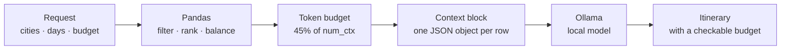

# LAB05 — Vietnam Trip Planner with a Local LLM

Plan a trip through Vietnam using a travel dataset and a language model that runs
**on your own machine** through [Ollama](https://docs.ollama.com/). Nothing is
sent to a cloud provider, and no API key is needed.

The project's central idea is a budget, not a prompt: a language model can only
attend to what fits in its **context window**, so pandas filters and ranks the
dataset first, and only the rows that match the request are packed into the
prompt. The model composes; pandas does the arithmetic.

| Deliverable | Where |
|---|---|
| Research brief (Exercise A) | [`docs/exercise-a-report.md`](docs/exercise-a-report.md) |
| Architecture and diagrams | [`docs/architecture.md`](docs/architecture.md) |
| Agent / contributor context | [`AGENT.md`](AGENT.md) |
| Application | [`app.py`](app.py) + [`src/travel_planner/`](src/travel_planner/) |
| Sample data in three formats | [`data/sample/`](data/sample/) |
| Tests (52, offline) | [`tests/test_pipeline.py`](tests/test_pipeline.py) |

---

## Quick start

```bash
python3 -m venv .venv
.venv/bin/pip install -r requirements.txt

# Mock mode: runs immediately, no model download.
.venv/bin/python app.py
```

Then open <http://localhost:7860>.

To use a real model:

```bash
# in another terminal
ollama serve
ollama pull gemma3:4b        # ~3 GB; qwen2.5:3b or llama3.2:3b are lighter

.venv/bin/python app.py --live --model gemma3:4b
```

Both modes use the same pipeline. Mock mode templates the prose so the whole
system — filters, token packing, prompt, budget table — can be exercised and
tested without a multi-gigabyte download.

---

## How it works



1. **Filter.** Hard constraints are applied to the DataFrame, so a row that
   cannot satisfy them never spends a token.
2. **Rank and balance.** Rows are scored by rating, review volume and price,
   then balanced by category — otherwise a quality ranking returns only
   landmarks, with nowhere to sleep.
3. **Pack.** Rows are added greedily until the token budget is full, so what gets
   dropped is the least relevant. The budget is 45% of the context window,
   capped at 6,000 tokens.
4. **Compose.** The model receives only those rows, as compact JSONL, plus
   statistics that pandas already computed. It is instructed to use no other
   place, and to list what the data could not cover under **Gaps**.

The UI exposes each stage: the retrieved rows, the exact context block, the token
accounting, and a comparison of three prompting strategies measured on your
current selection.

---

## Data

`data/sample/` holds the same 54 hand-curated places and 12 cities in **CSV, JSON
and JSONL**, so all three parsers are exercised for real. Switch between them in
the app under *Dataset and model* and watch the format label change while the
results stay identical — `tests/test_pipeline.py` asserts exactly that.

Regenerate all three files from one source:

```bash
.venv/bin/python scripts/build_sample_data.py
```

### Bringing in a real Kaggle dataset

Kaggle needs your own API token, which is never committed:

```bash
# one-time: kaggle.com -> Settings -> API -> Create New Token
mkdir -p ~/.kaggle && mv ~/Downloads/kaggle.json ~/.kaggle/ && chmod 600 ~/.kaggle/kaggle.json
pip install kaggle

.venv/bin/python scripts/download_kaggle.py --dataset owner/dataset-slug
```

Files land in `data/raw/`, which is git-ignored. A downloaded file almost never
uses this project's column names, so
[`config/vietnam-tourism.mapping.json`](config/vietnam-tourism.mapping.json)
declares how to translate its headers, city names and category words:

```python
from travel_planner.adapter import autodetect_profile, load_mapped
frame = load_mapped("data/raw/…/places.csv", autodetect_profile("data/raw/…/places.csv"))
```

The brief recommends [Holidify — Places Data](https://www.kaggle.com/datasets/himanshutripathi/places-to-explore)
for its Vietnam file, and explains why in
[§3 of the report](docs/exercise-a-report.md#3-kaggle-datasets-and-a-vietnam-travel-dataset).

---

## CLI

```
python app.py [--live] [--model TAG] [--host URL] [--num-ctx N] [--port N] [--share]
```

| Flag | Meaning |
|---|---|
| `--live` | Use Ollama instead of the deterministic mock |
| `--model` | Ollama model tag (default `gemma3:4b`) |
| `--num-ctx` | Context window passed to Ollama (default `8192`) |
| `--port` | Port to bind (default `7860`) |
| `--share` | Create a temporary public Gradio link |

The server binds `0.0.0.0` so it also works behind a container or proxy.

---

## Tests

```bash
.venv/bin/python -m pytest tests -q      # 52 passed in ~1s
```

Everything is offline. Coverage worth knowing about:

- the three formats produce **identical** frames, not merely similar ones
- the token packer never exceeds its budget and drops the least relevant rows
- a plan names only places that were retrieved — no invented hotels
- day counts match the request, city choices are respected
- the adapter maps foreign columns, city aliases and category synonyms
- malformed JSONL and unsupported formats produce useful errors

---

## Project layout

```
app.py                     Gradio UI
src/travel_planner/
  loader.py                CSV / JSON / JSONL → one canonical DataFrame
  adapter.py               map a Kaggle file onto that schema
  dataset.py               filtering, ranking, groupby statistics   [pandas layer]
  context.py               token estimation, packing, budget planning
  prompts.py               prompt templates
  llm.py                   Ollama client + deterministic mock
  planner.py               orchestration
scripts/                   build the sample data · download from Kaggle
config/                    column/alias mapping profiles
data/sample/               committed dataset in csv, json, jsonl
docs/                      research brief · architecture
tests/                     offline test suite
```

---

## Notes and limits

- The bundled sample is **illustrative, not a booking source**. Prices, ratings
  and review counts are realistic placeholders, not live data. Confirm anything
  you would rely on before travelling.
- `MockLLM` templates its prose; it verifies the pipeline, not writing quality.
  Run `--live` for real composition.
- Token counts are estimated at ~4 characters per token. Deterministic and good
  enough for budgeting, but not a substitute for a model's own tokeniser.
- Vietnamese text tokenises less efficiently than English, so treat every token
  estimate as approximate and leave headroom.
