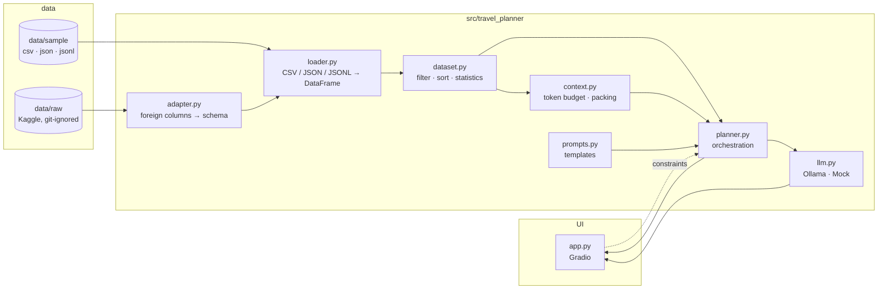
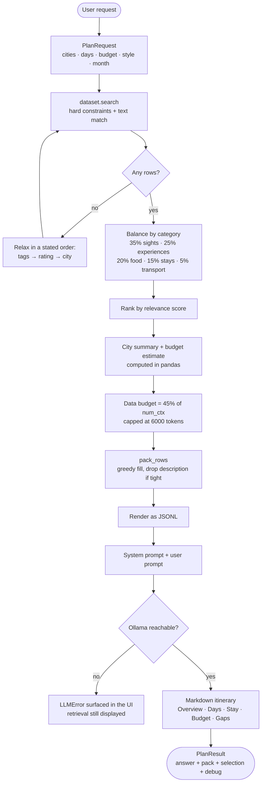
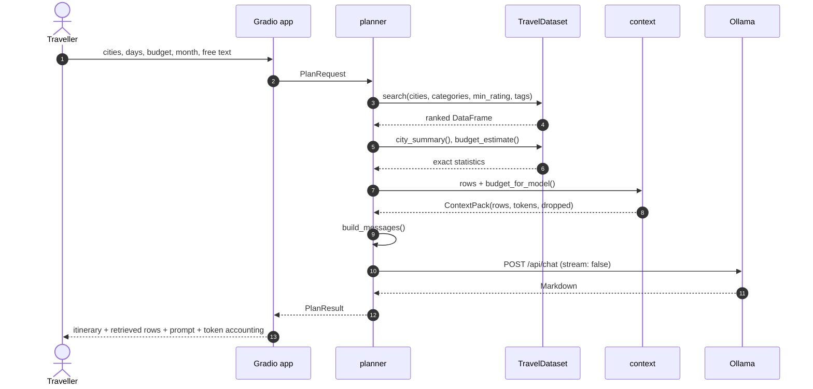
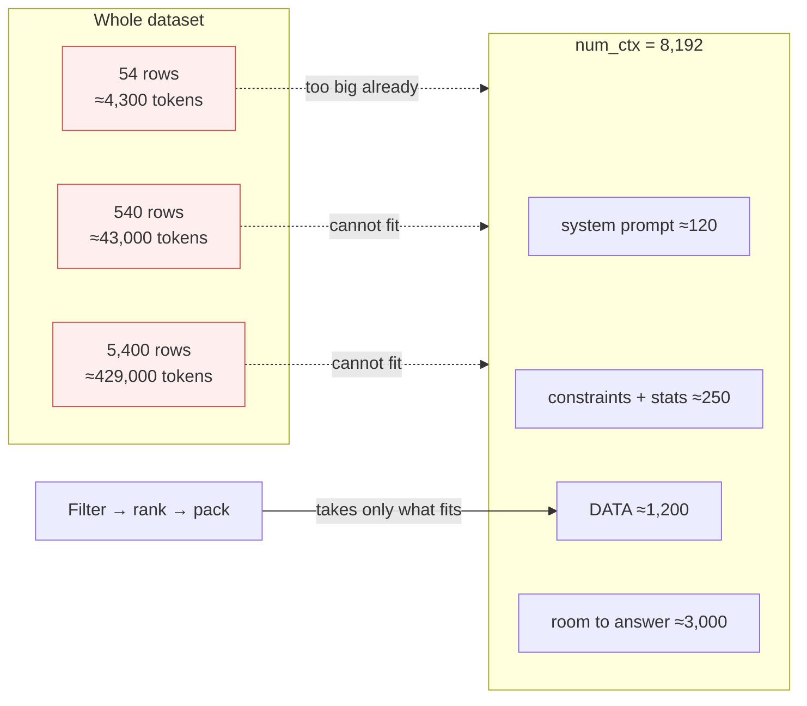
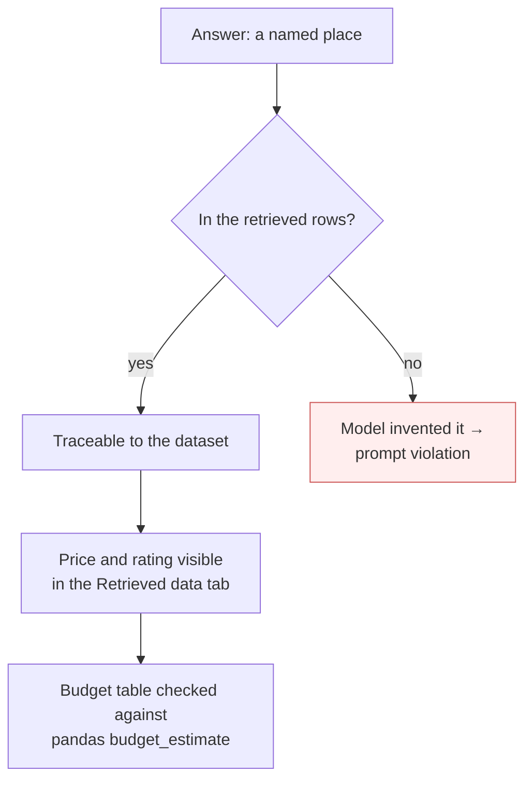
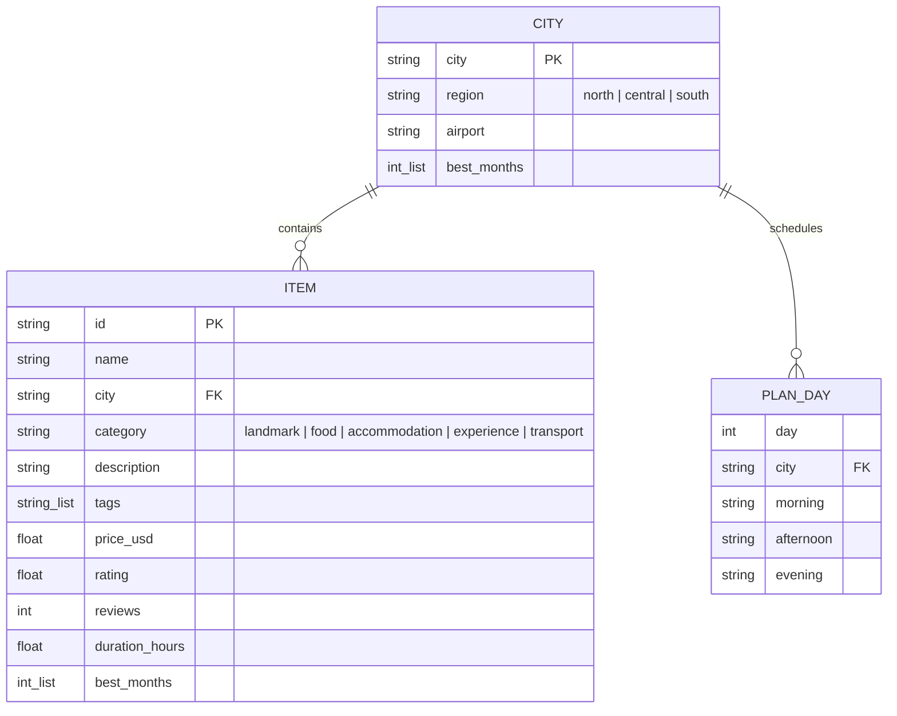

# Architecture

How a request becomes an itinerary, and why the code is split the way it is.

## Module map

**The rule that keeps this maintainable:** pandas lives only in `dataset.py`, and
the model is reached only through `llm.py`. Everything else is pure functions
over plain dicts. That is what lets the whole pipeline run with `MockLLM` in
tests, with no network and no model download.

## The planning pipeline

## Sequence of a plan request

## The context-window design in one picture

Data flow in the opposite direction, for the person reading the answer:

## Data model

`cities.json` is deliberately a *different* JSON shape from `travel_vn.json` —
an object with a `cities` array, rather than an object with an `items` array.
Having two shapes in the sample data forces the loader to handle both instead of
hard-coding one, which is what a real Kaggle file will demand.

## Where each format is exercised

| Format | File | Read by | What it demonstrates |
|---|---|---|---|
| CSV | `data/sample/travel_vn.csv` | `read_csv_rows` | Flat table; lists packed as `a|b|c` and split on read |
| JSON | `data/sample/travel_vn.json` | `read_json_rows` | Wrapped array; native types and list fields |
| JSONL | `data/sample/travel_vn.jsonl` | `read_jsonl_rows` | Line-by-line streaming; bad line reports its number |
| JSON (different shape) | `data/sample/cities.json` | `_locate_records` | Object-of-array wrapper; shape autodetection |
| Any | `data/raw/**` | `adapter.load_mapped` | Column renaming + city/category aliases |

## Failure behaviour

Deliberate choices, because a demo that dies is worse than one that explains:

| Situation | Behaviour |
|---|---|
| Ollama not running | `LLMError` with instructions; the UI still shows the retrieved rows |
| Model not pulled | Error names the model and the `ollama pull` command |
| Filters match nothing | Constraints relax in a fixed order; if still empty, the app says so |
| Budget too small for even one row | Descriptions are dropped; if still too small, the pack reports `dropped_rows` |
| Malformed JSONL line | Error reports the line number instead of failing silently |
| Unknown file extension | `DatasetError` listing the supported formats |
