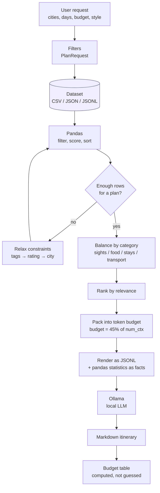
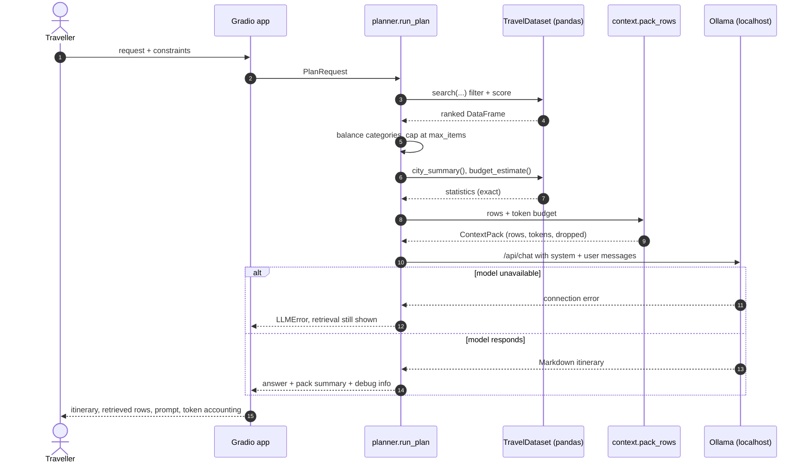

# Exercise A — Research Brief

**Lab 05 · Data formats, Mermaid, Kaggle datasets and the LLM context window**

This brief answers the five research questions from the lab sheet, and each
answer is tied back to the app that this repository builds: a Vietnam trip
planner that runs entirely on a local model through Ollama.

| # | Topic | Section |
|---|---|---|
| 1 | Mermaid: supported diagrams and embedding in Notion | [§1](#1-mermaid-diagrams-and-notion) |
| 2 | CSV, JSON, JSONL and the role of Pandas | [§2](#2-csv-json-jsonl-and-pandas) |
| 3 | Kaggle Datasets and a Vietnam travel recommendation | [§3](#3-kaggle-datasets-and-a-vietnam-travel-dataset) |
| 4 | The LLM context window | [§4](#4-the-llm-context-window) |
| 5 | Using the dataset as the LLM's source of truth | [§5](#5-design-using-the-dataset-as-the-llms-source-of-truth) |

---

## 1. Mermaid diagrams and Notion

### What Mermaid is

Mermaid is a JavaScript library that renders diagrams from a small plain-text
language. The diagram is *source code*, stored in the repository next to the
document it explains, so it diffs, reviews and versions like any other file.
That is the practical reason it beat drag-and-drop diagram tools for
documentation.

### Supported diagram types

Mermaid ships two tiers: stable syntax that will not change, and experimental
types marked with a `-beta` suffix, where the syntax may still break between
releases.

| Category | Type | Declaration | Useful for |
|---|---|---|---|
| Process | Flowchart | `flowchart TD` / `graph LR` | Pipelines, decision trees, the app's data flow |
| Process | User journey | `journey` | Experience mapping, satisfaction over a trip |
| Process | Kanban, Swimlane | `kanban`, `swimlane-beta` | Task boards, cross-team handoffs (beta) |
| Interaction | Sequence | `sequenceDiagram` | API calls, request/response between app and Ollama |
| Interaction | ZenUML | `zenuml` | Code-style sequence syntax (plugin) |
| Structure | Class | `classDiagram` | Object design, the app's dataclasses |
| Structure | ER | `erDiagram` | Database schemas — see §2 |
| Structure | Block, Architecture | `block-beta`, `architecture-beta` | System layout, infrastructure (beta) |
| Structure | C4 | `C4Context`, `C4Container`, `C4Deployment` | System context for larger products |
| Behaviour | State | `stateDiagram-v2` | Lifecycles: a planning request's states |
| Behaviour | Requirement | `requirementDiagram` | Traceability from requirement to implementation |
| Data | Pie, XY chart | `pie`, `xychart-beta` | Category shares, bar/line charts (beta) |
| Data | Quadrant, Radar | `quadrantChart`, `radar-beta` | Priority matrices, multi-axis comparison |
| Data | Sankey, Treemap | `sankey-beta`, `treemap` | Flows (e.g. budget split), hierarchical proportions |
| Planning | Gantt, Timeline | `gantt`, `timeline` | Schedules, project chronology |
| Versioning | Git graph | `gitGraph` | Branching strategy |
| Thinking | Mindmap | `mindmap` | Brainstorming, topic breakdown |
| Thinking | Venn, Ishikawa | `venn-beta`, `ishikawa` | Set overlap, root-cause analysis |
| Network | Packet | `packet-beta` | Protocol and binary layouts |

**Choose by question, not by aesthetics.** "What happens next?" is a flowchart;
"who talks to whom, in what order?" is a sequence diagram; "what is the shape of
the data?" is an ER diagram. Getting this wrong is the most common reason a
diagram is unreadable even though it renders perfectly.

### How to embed Mermaid in Notion

Notion renders Mermaid natively inside a code block, so no plugin, embed service
or image export is needed for day-to-day work:

1. Type `/mermaid` (or `/code` and pick **Mermaid** from the language list).
2. Paste the diagram source, without the surrounding triple backticks.
3. Switch the block's view from **Code** to **Preview** or **Split** using the
   view selector at the top-left of the block.

Things worth knowing before relying on it:

- **One fixed theme.** Notion ignores `%%{init: ...}%%` directives and
  `themeVariables`, so `classDef` customisation may be dropped. Design diagrams
  that read well in the default palette rather than fighting it.
- **No image export.** If you need a PNG for a slide or a report, render the
  same source with the [Mermaid Live Editor](https://mermaid.live) or
  `@mermaid-js/mermaid-cli` and insert the image.
- **Narrow columns hurt.** Wide flowcharts compress badly inside a page column;
  prefer `flowchart TD` with short node labels, and split a large diagram in two.
- **PDF export** captures whichever view is active, so switch to **Preview**
  before exporting a page.

The exercise asked for a flowchart *and* another diagram type. Both are used in
this repository's [`docs/architecture.md`](architecture.md): a flowchart for the
request pipeline and a sequence diagram for the same flow over time.

---

## 2. CSV, JSON, JSONL and Pandas

### The three formats compared

| | **CSV** | **JSON** | **JSONL** (JSON Lines) |
|---|---|---|---|
| Shape | One flat table | One document: objects, arrays, nesting | One JSON object per line |
| Types | None — everything is text | Numbers, booleans, null, nested arrays | Same as JSON, per line |
| Nesting | Not possible; lists get squashed into one cell | Native | Native, per record |
| Read strategy | Parse the whole file into a frame | Parse the whole file into memory | Stream line by line |
| Append a record | Append a row (safe if no quoting edge case) | Rewrite the closing bracket | Append one line |
| Corrupt data | Usually shifts every column to the right | Whole document fails to parse | One line fails, the rest survive |
| Human-readable | Very, for tabular data | Yes, but verbose | Yes, one record per line |
| Best for | Spreadsheet exports, quick inspection, Excel round-trips | Configuration, API responses, nested documents | Logs, scraped data, LLM fine-tuning, streaming pipelines |

**CSV** is the lingua franca of tabular data because every tool reads it, but it
carries no type information and no nesting. Our sample dataset has a `tags`
column that is genuinely a list; in CSV it has to become `"beach|swimming|free"`
and be split again on read. That round trip is lossy if a tag ever contains the
separator — the reason CSV escaping rules exist.

**JSON** carries real types and nesting, which is why it dominates APIs. Its
weakness in a data pipeline is structural: because the whole document is one
value, a producer must hold all of it in memory, and a single bad byte
invalidates everything.

**JSONL** keeps JSON's types but drops the envelope: each line is an independent,
self-contained record. That makes files appendable, streamable and
failure-tolerant — a bad line is a bad line, not a corrupt file. It is the
standard format for training data (one example per line) and for logs, and it is
the format this app sends to the model, because a JSONL context block lets the
model read record *n* without needing to understand a nested wrapper.

**Measured on this repository's sample** (54 rows, identical content in all three
files, average of 50 loads):

| Format | File size | Load time | Rows |
|---|---|---|---|
| `travel_vn.csv` | 16.3 KiB | 5.60 ms | 54 |
| `travel_vn.json` | 42.6 KiB | 3.33 ms | 54 |
| `travel_vn.jsonl` | 30.0 KiB | 3.43 ms | 54 |

CSV is the smallest because it has no repeated keys; it is also the slowest here,
because the list columns have to be split back into arrays after parsing. The
sizes say nothing about which format is "best" — they measure how much of each
file is structural overhead.

### The role of Pandas

Pandas is the layer that makes all three formats *interchangeable*. It loads each
one into the same in-memory structure, a `DataFrame` — a labelled, typed,
column-oriented table — and from then on the code does not care where the bytes
came from. In this project that layer is [`src/travel_planner/loader.py`](../src/travel_planner/loader.py),
which normalises all three files onto one schema, and
[`dataset.py`](../src/travel_planner/dataset.py), which does the querying.

The three operations the lab asks about, as they are actually used here:

**Filtering** — boolean masking builds a condition per row, and conditions
combine:

```python
mask = (frame["city"].isin(["Hoi An"])) \
     & (frame["price_usd"] <= 10) \
     & (frame["rating"] >= 4.0)
cheap_hoi_an = frame[mask]
```

The app's `TravelDataset.search()` generalises this to city, region, category,
price, rating, month and tags, and treats an unset filter as "no condition"
rather than as a bug.

**Sorting** — because a token budget truncates the list, *order is content*. The
app sorts by a relevance score that mixes quality, popularity and price:

```python
score = rating * 20 + reviews.clip(upper=25_000) / 5_000 - price_usd / 25
ranked = selected.assign(_score=score).sort_values(["_score", "rating"], ascending=False)
```

Sorting by rating alone would return only landmarks; the composite lets a
well-reviewed cheap restaurant outrank an expensive, mediocre attraction.

**Computing statistics** — `groupby` computes per-city aggregates in one pass.
These numbers are then handed to the model as facts, so the model never has to
do arithmetic over a table (which is exactly where LLMs fabricate):

```python
frame.groupby(["city", "region"], as_index=False).agg(
    items=("id", "count"),
    avg_rating=("rating", "mean"),
    avg_price_usd=("price_usd", "mean"),
)
```

A secondary benefit worth stating: pandas is deterministic and free, and it
returns an exact answer. Asking a language model to average 54 rows produces a
plausible number that may simply be wrong.

### Formats and schema drift

One practical problem the app has to solve: a real Kaggle download will not use
our column names. [`adapter.py`](../src/travel_planner/adapter.py) maps arbitrary
headers onto the canonical schema using a small JSON profile
([`config/vietnam-tourism.mapping.json`](../config/vietnam-tourism.mapping.json)),
including alias tables for city names (`Ha Noi` → `Hanoi`) and category
synonyms (`restaurant` → `food`). Without this step, "the dataset" and "the app"
are two different things that happen to share a file.

---

## 3. Kaggle Datasets and a Vietnam travel dataset

### What Kaggle Datasets is

Kaggle is a data-science competition platform owned by Google, and **Datasets** is
its public data-sharing layer: hundreds of thousands of uploaded datasets, each
with a description, file listing, licence, download count and discussion tab.
Practically, it serves three purposes:

1. **Supply.** It is the fastest place to find a real-world table for a project
   when no official API exists.
2. **Reproducibility.** Each dataset is versioned, so a notebook can point at a
   specific version instead of "whatever the URL returns today".
3. **Provenance.** The licence, the uploader and the update history are visible,
   which matters if the output leaves the classroom.

Its weakness is equally important to name: much of the content is uploaded for
exercises, so quality varies enormously. Two datasets with near-identical titles
can differ in whether the values are real. **Always check the licence, the last
update date and whether the rows look like measurements or like generated
noise before building on one.**

### File formats you meet there

| Format | Typical Kaggle use |
|---|---|
| **CSV** | The default for every tabular dataset |
| **JSON / JSONL** | Nested records, scraped APIs, one object per line for text corpora |
| **Parquet** | Larger datasets: columnar, compressed, typed; needs `pyarrow` |
| **SQLite / DB** | Relational dumps, several related tables |
| **Images / audio / zip** | Computer-vision and speech competitions |

The type of data also shapes the choice: tabular (CSV/Parquet), text (JSONL,
plain text, one document per line), image (folders plus a label CSV), and
time series (CSV with a timestamp column, or Parquet for volume).

### Recommendation for this project

The app needs one row per *place*, with enough fields to plan a day: what it is,
where it is, what it costs, how long it takes, and ideally when to go. The
canonical schema in [`loader.py`](../src/travel_planner/loader.py) is built around
exactly those questions.

**Recommended: [Holidify — Rating / Places Data](https://www.kaggle.com/datasets/himanshutripathi/places-to-explore)**
(`himanshutripathi/places-to-explore`), using its `vietnam.csv` file.

Why this one:

- **It matches the task's shape.** Each of the six CSVs is one country with four
  columns: *Place Name, Rating, About Place, Best Time To Visit*. That maps
  directly onto `name`, `rating`, `description` and `best_months` — four of the
  fields the planner actually uses — with no reshaping.
- **It carries the prose the LLM needs.** `About Place` is a short description,
  which is the field that gives the model something to reason about. A dataset of
  bare coordinates or bare prices would leave the model with nothing to compose
  from.
- **`Best Time To Visit` enables seasonality**, the one filter a generic travel
  dataset usually omits. It becomes the app's `best_months` field.
- **It is a real curated source.** The values come from Holidify, a commercial
  travel site, rather than being randomly generated — unlike several
  "Tourist Destinations"-style datasets on Kaggle whose ratios and visitor counts
  are synthetic.

**Its gaps, stated honestly.** It has no prices, no coordinates, no city column
and no accommodation or restaurant rows. So it answers "what is worth seeing in
Vietnam, and when", but not "where do I sleep and what does a day cost". Those
gaps are why this repository ships a curated sample (`data/sample/`) with all
eighteen canonical fields across twelve cities, plus a
[downloader](../scripts/download_kaggle.py) and a
[mapping profile](../config/vietnam-tourism.mapping.json) for bringing in the real
file. Merging the two — Kaggle for descriptive depth, the sample for structure
and pricing — is the realistic design, and the app is built for that: any file
that maps onto the schema can be swapped in without changing a line of the
planner.

Two alternative sources worth knowing, if the recommendation does not fit:

| Dataset | Strength | Why not chosen as first pick |
|---|---|---|
| [Vietnam Tour Bookings](https://www.kaggle.com/datasets/ngchno/vietnam-tour-bookings) | Real-looking booking records: destination, traveller type, payment, dates | It describes *transactions*, not *places*; you cannot build a day plan from a booking row |
| [VNBooking](https://www.kaggle.com/datasets/quandang/vnbooking) | Large Vietnamese hotel-review corpus (CC BY-NC-SA 4.0) | Sentiment/NLP data; reviews in Vietnamese, not structured attributes |

---

## 4. The LLM context window

### What it is

A language model does not have memory. Each request is one forward pass over the
tokens you send: system prompt, user request, and any data you include. The
**context window** is the maximum number of tokens that pass can attend to —
input and output combined.

A **token** is not a word: it is a chunk of characters, roughly 4 characters or
¾ of a word in English, and rather fewer characters in Vietnamese, where
diacritics and word boundaries make tokenisation less efficient. Every figure
below should be treated as approximate for that reason.

### Sizes to keep in mind

| Model family (typical local builds) | Context window |
|---|---|
| `phi3` (mini) | 4,096 tokens |
| `llama3`, `gemma2` | 8,192 tokens |
| `qwen2.5` | 32,768 tokens |
| `llama3.1`, `gemma3` | 128,000 tokens |

Those are the *architectural maxima*. What you actually get in Ollama is set by
`num_ctx`, whose default is much smaller than the model's ceiling, which is why
`llm.py` passes `num_ctx` explicitly rather than hoping for the best.

### What happens when you exceed it

Nothing graceful. The server truncates the input — usually the *end*, so the
model may never see your actual question — or the request fails outright. And
increasing the window is not a free fix:

- **Cost and latency grow with length**, linearly for attention over the prompt
  on a local machine: every extra token is real compute.
- **Accuracy does not grow with it.** Accuracy degrades for information placed in
  the middle of a long context, the "lost in the middle" effect described by Liu
  et al. ([arXiv:2307.03172](https://arxiv.org/abs/2307.03172)). A fact buried at
  position 40,000 of 60,000 is less likely to be used than the same fact near the
  start.
- **Small local models degrade sooner** than the large hosted ones used in most
  published benchmarks, so a 7B model's usable context is often well below its
  declared maximum.

The lesson for this project: **the question is not "does the dataset fit?", it is
"which part of the dataset belongs in this request?"** — which is precisely what
§5 designs.

### The arithmetic for our data

Rendered as compact JSON one-object-per-line, the bundled 54-row dataset costs
**4,295 tokens**. Packed into a context block it costs **1,158 tokens** for a
4-day, 2-city plan — 27% of the full table, for a selection that is strictly more
useful because every row is relevant.

Scaling that up is where the design decision becomes unavoidable:

| Dataset size | Tokens if dumped whole | Fits an 8k window? | Fits a 128k window? |
|---|---|---|---|
| 54 rows (this sample) | ~4,300 | No (leaves no room to answer) | Yes |
| 540 rows | ~43,000 | No | Yes |
| 5,400 rows | ~429,500 | No | No |
| 54,000 rows | ~4,295,000 | No | No |

A real Kaggle travel dataset easily reaches tens of thousands of rows. So
"put the data in the prompt" is not a design that survives contact with a real
dataset — it is a demo that works only on a sample.

---

## 5. Design: using the dataset as the LLM's source of truth

The lab's hint frames the choice correctly: *put the entire dataset into every
prompt, or preprocess it first so only the relevant data is used?* The numbers
above rule out the first option beyond toy scale, so the design is a three-stage
pipeline in which **pandas decides what the model may see, and the model only
composes**.

### Three candidate strategies, measured

| | Whole dataset in prompt | Pre-computed summary | **Filter → retrieve → pack** (this app) |
|---|---|---|---|
| Prompt size, 54 rows | ~4,300 tokens | ~220 tokens (constant) | ~1,200 tokens |
| Scales with dataset size | Linearly — unusable past a few thousand rows | No | No: capped by budget |
| Grounded in real names/prices | Yes | Partly | Yes |
| Answers a *specific* request | Yes, if it fits | No | Yes |
| Main weakness | Does not fit; slow; mid-context facts ignored | Cannot answer detail questions | Recall depends on the filters and the ranking |

### The pipeline as implemented



The same flow over time, which makes the failure modes visible — note that the
model is only ever reached with a bounded, filtered payload:



### The four rules that make it trustworthy

**1. Filter with pandas, not with the prompt.** Hard constraints (city, category,
price ceiling, minimum rating, month) are applied to the DataFrame before
anything is rendered. A row that cannot satisfy the constraint never spends a
token, and — more importantly — the model cannot be tempted to offer it.

**2. Rank, because truncation is inevitable.** The token budget will cut the
list, so what survives must be the best rows. The score combines rating,
review volume and price, and the selection is then *balanced across categories*
— a purely relevance-ranked list returns only landmarks, leaving the plan with
nowhere to sleep.

**3. Let the model see only what it can use.** Fields are pruned to
`name, city, category, price_usd, rating, duration_hours, tags, description`, and
descriptions are truncated. Ids, coordinates and street addresses are dropped:
they cost tokens and cannot improve a prose itinerary. What remains is rendered
as one JSON object per line, because JSONL keeps real place names and prices
copyable — where prose invites paraphrase and, eventually, invention.

**4. Do the maths in pandas and pass the results as facts.** Averages, per-city
counts and budget estimates are computed by `city_summary()` and
`budget_estimate()` and handed to the model labelled as pre-computed. The model
is told not to recompute them. This is the difference between an itinerary whose
budget table is arithmetic and one whose budget table is vibes.

### Guarding the output

Retrieval is not enough on its own: a model can still invent a hotel. The system
prompt forbids any place not in the context and requires a **Gaps** section for
what the data could not cover; the answer is then checkable, because the
*Retrieved data* tab shows exactly which rows the model was given. When the
filters match nothing, the pipeline does not hide it — it relaxes in a stated
order (tags → rating → city) and, if still empty, says so rather than inventing a
trip. `tests/test_pipeline.py` asserts this: no place name outside the selection
may appear in the answer.

### Why this is the right answer to the exercise

The context window is a budget, and the whole design is an exercise in spending
it well. Dumping the dataset spends the budget on irrelevant rows and performs
*worse* than a small, well-chosen set. A summary spends almost nothing but
throws away the detail that makes a plan specific. Filtering, ranking and packing
spends the budget on exactly the rows that answer the question — and it is the
only one of the three that still works when the dataset grows by a factor of a
thousand.

---

## References

1. Mermaid — diagram syntax and supported types: <https://mermaid.js.org/intro/>
2. Mermaid — flowchart and sequence diagram documentation: <https://mermaid.js.org/syntax/flowchart.html>
3. Notion — enhanced markdown, Mermaid code blocks: <https://developers.notion.com/guides/data-apis/enhanced-markdown>
4. Pandas — user guide: <https://pandas.pydata.org/docs/user_guide/index.html>
5. Pandas — `groupby` and aggregation: <https://pandas.pydata.org/docs/user_guide/groupby.html>
6. JSON Lines format: <https://jsonlines.org/>
7. RFC 4180 — common format for CSV files: <https://www.rfc-editor.org/rfc/rfc4180>
8. Kaggle Datasets: <https://www.kaggle.com/datasets>
9. Holidify places dataset: <https://www.kaggle.com/datasets/himanshutripathi/places-to-explore>
10. Ollama — API and `num_ctx`: <https://docs.ollama.com/>
11. Ollama model library: <https://ollama.com/library>
12. Liu et al., *Lost in the Middle: How Language Models Use Long Contexts*, TACL 2024: <https://arxiv.org/abs/2307.03172>
13. Gradio documentation: <https://www.gradio.app/docs>
